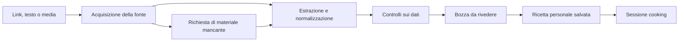

# Recipeek — prima esplorazione del prodotto

Ricerca del **16 ottobre 2026**. Contesto concordato: uso personale e amici, sviluppo da parte di Riccardo con supporto AI, eventuale prodotto commerciale in seguito. Questo documento contiene **proposte da discutere**, non decisioni architetturali approvate né un impegno su tempi e costi.

Approfondimenti e fonti: [mercato](2026-10-16-market.md), [fattibilità degli import](2026-10-16-import-feasibility.md), [costi e formule](2026-10-16-costs.md). La ricerca è documentale: non abbiamo eseguito import reali, installato i concorrenti per un confronto o misurato accuratezza e latenza.

**Aggiornamento successivo al confronto:** le fonti prioritarie confermate sono Instagram, TikTok, siti e fotografie di pagine di libri. È stato preparato un laboratorio locale per queste origini, ancora da collaudare con i provider reali. Il [piano della prova](2026-10-16-import-spike.md) e il [README](../../README.md) descrivono il lavoro corrente; le ipotesi iniziali sotto vanno lette alla luce di questo aggiornamento.

## Valutazione iniziale

Una beta privata è fattibile. Il vincolo principale è ottenere dalle diverse fonti abbastanza informazioni utilizzabili per ricostruire una ricetta, con un metodo mantenibile. La capacità del modello di comprendere testo e immagini è soltanto una parte del problema.

La promessa di prodotto proposta è: **trasformare una ricetta trovata online in una ricetta personale verificabile, facile da ritrovare e da cucinare**. Il primo risultato da misurare è quante ricette vengono effettivamente cucinate, quanto tempo serve a correggere la bozza e quanto spesso occorre tornare alla fonte.

## Mercato: esistono confronti molto vicini

ReciMe e CookBook offrono già import social e gestione delle ricette. CookBook documenta anche revisione dell'import; Pestle e Crouton sono riferimenti per l'esperienza durante la cucina; Samsung Food copre la dimensione comunitaria. Paprika 4 è in open beta dal 28 settembre 2026 e introduce import social. [CookBook import](https://cookbookmanager.com/features/add-import-and-create-recipes), [ReciMe](https://www.recime.app/), [Pestle](https://pestlechef.app/), [Crouton](https://crouton.app/), [Samsung Food](https://samsungfood.com/food-plus/), [Paprika 4](https://www.paprikaapp.com/news/2026/09/28/paprika-4-is-now-in-open-beta/).

I limiti interessanti sono concreti: una ricetta può essere nei commenti, una didascalia può omettere le dosi, un contenuto può richiedere login. ReciMe documenta questi casi. Non abbiamo misurato la loro frequenza né il tasso di errore dei concorrenti. [Help ReciMe](https://www.recime.app/help/en/articles/14773584-why-didn-t-my-recipe-import-correctly).

Anche il calcolo per teglie ha precedenti: CookBook pubblica un convertitore per area e suggerisce di applicare il fattore alle porzioni. Un'eventuale differenza di Recipeek sarebbe l'integrazione nel flusso, non l'invenzione del calcolo. [Convertitore CookBook](https://cookbookmanager.com/tools/baking-pan-converter).

Tre ipotesi da provare, senza presentarle come vantaggi già dimostrati:

1. Revisione mirata: distinguere informazioni lette nella fonte, suggerimenti e dati mancanti.
2. Passaggi utilizzabili in cucina: dosi pertinenti, riferimenti alla fonte e ripresa della sessione.
3. Buona gestione italiana di ingredienti, unità, sinonimi e appunti personali dopo aver cucinato.

Per uso personale, costruire un flusso che risolva le proprie frizioni può giustificare il progetto anche senza una funzione esclusiva. Un futuro lancio commerciale richiederà invece prove di utilità e disponibilità a pagare.

## Fattibilità per origine

| Origine | Ipotesi di supporto iniziale | Incognita principale |
| --- | --- | --- |
| Inserimento manuale e testo | Percorso principale | Facilità dell'editor |
| Siti di ricette | Dati strutturati prima dell'AI, sui siti verificati | Layout, login, completezza e diritti d'uso |
| YouTube pubblico | Prova con input URL Gemini | Preview, qualità sui video reali, quote |
| Instagram e TikTok | Verifica separata; fallback esplicito a testo/materiale fornito dall'utente | Acquisizione effettiva, permessi, continuità |
| Foto o video propri/autorizzati | Percorso aggiuntivo circoscritto | Dimensione, durata e costo |

Lo schema `Recipe` dei siti può includere ingredienti e istruzioni già strutturate. Gemini documenta input di URL YouTube pubblici, ancora in preview: questo non implica supporto identico per altri social o diritti di ripubblicazione dei media. [Google Recipe](https://developers.google.com/search/docs/appearance/structured-data/recipe), [Gemini video](https://ai.google.dev/gemini-api/docs/video-understanding).

La TikTok Display API riguarda i video dell'utente autorizzato; Instagram API è orientata ad account professionali. Non abbiamo verificato un percorso ufficiale universale per i video arbitrari di terzi. Le pagine dirette Meta oEmbed non erano accessibili durante la ricerca: è un punto aperto, non una dimostrazione di impossibilità. [TikTok](https://developers.tiktok.com/docs/en/tiktok-api-v2-video-query), [documentazione Meta](https://www.postman.com/meta/instagram/folder/6raa77c/instagram-api-with-instagram-login).

Se il bisogno reale è quasi tutto su Instagram, non conviene cambiare obiettivo solo perché YouTube è più facile: prima si deve capire se Instagram è sostenibile. In alternativa, la beta deve dichiarare chiaramente il compromesso e raccogliere feedback sul fallback.

## MVP proposto

| Funzione | Prima beta | Evoluzione |
| --- | --- | --- |
| Smartphone e tablet | iPhone/iPad, UI adattiva, base cross platform | Verifica e distribuzione Android |
| Autenticazione | Accesso gestito, Apple/Google; pochi provider | Altri provider se richiesti |
| Catalogo | Creazione, modifica, eliminazione, preferiti, foto disponibili | Raccolte condivise |
| Import | Un percorso verificato, testo/manuale come recupero | Estendere piattaforma per piattaforma |
| Bozza | Modifica, rigetto, campi mancanti e fonte visibili | Revisione più rapida basata sui feedback |
| Cooking | Uno step alla volta, ingredienti pertinenti, avanti/indietro, schermo attivo, ripresa | Comandi vocali e altri automatismi |
| Media negli step | Previsti ma facoltativi | Clip e timestamp dove tecnicamente e contrattualmente disponibili |
| Ricerca | Titolo, ingredienti, categoria, tempi e metodo di cottura | Suggerimenti contestuali e dispensa |
| Quantità | Porzioni con quantità strutturate | Teglie su casi ben definiti, poi altri vincoli |
| Social | Catalogo privato; condivisione semplice come iterazione successiva | Follow, feed, moderazione |

Le ricette già salvate dovrebbero rimanere consultabili con rete debole: una cache locale di lettura è una prima soluzione. La modifica offline con risoluzione dei conflitti è un problema distinto e può attendere.

La condivisione tra amici può iniziare da una ricetta o raccolta, senza costruire subito un feed pubblico. Introdurre contenuti visibili tra utenti aggiunge comunque gestione di permessi e segnalazioni; per un lancio pubblico vanno considerate le regole UGC dello store. [Apple App Review Guidelines](https://developer.apple.com/app-store/review/guidelines/).

## Come rendere utile la bozza AI

Proposta: un modello multimodale esistente genera dati strutturati; non serve iniziare addestrando un modello proprio. La scelta del provider viene dopo il confronto su un campione reale.

I controlli devono coprire almeno tre aspetti: contenuto culinario o pertinente; struttura valida; coerenza tra ingredienti, dosi e passaggi. Una risposta può essere una ricetta completa, una ricetta parziale, materiale insufficiente o contenuto non pertinente. Un JSON valido da solo non dimostra correttezza.

Se la fonte dice «aggiungi la farina» senza dose, il campo resta mancante. Un suggerimento eventuale va separato dall'estrazione. Eviterei percentuali di fiducia inventate dal modello: un estratto o un timestamp sono più utili per controllare un dato.

Il contenuto importato resta dato non attendibile, non istruzione eseguibile. Le URL vanno validate anche dopo redirect e per i media collegati; il modello non deve accedere a segreti o compiere azioni esterne. Questi sono requisiti tecnici della pipeline, non schermate aggiuntive per l'utente. [OWASP prompt injection](https://cheatsheetseries.owasp.org/cheatsheets/LLM_Prompt_Injection_Prevention_Cheat_Sheet.html), [OWASP SSRF](https://cheatsheetseries.owasp.org/cheatsheets/Server_Side_Request_Forgery_Prevention_Cheat_Sheet.html).

## Tre scelte sui dati da fare bene subito

**Ingredienti collegati agli step.** «200 g di zucchero» può significare 150 g nell'impasto e 50 g nella crema. Ogni step dovrebbe riferirsi all'ingrediente della ricetta, con una quantità parziale solo quando nota. Ripetere la dose totale in ogni step sarebbe un errore. L'anagrafica ingredienti cresce dalle ricette confermate: nome canonico, alias, forma e unità rimangono distinti. La stringa originale si conserva per la revisione. Non servono un'enciclopedia alimentare completa o un database vettoriale per iniziare.

**Porzioni e teglie separate.** Per le porzioni: `nuove porzioni / porzioni originali confermate`. «q.b.» resta qualitativo. Per due teglie tonde, a parità di altezza dell'impasto e compatibilità della ricetta, il rapporto delle aree è il quadrato del rapporto dei diametri: da 20 a 26 cm, `26² / 20² = 1,69`. Si tratta di un calcolo geometrico, non di una garanzia culinaria. Tempi, temperatura, profondità e materiale richiedono considerazioni ulteriori; non vanno moltiplicati automaticamente. [King Arthur Baking](https://www.kingarthurbaking.com/blog/2025/08/18/baking-pan-size).

**Fonte, bozza e ricetta personale separate.** La fonte può sparire o cambiare. Dopo la conferma, le modifiche personali appartengono alla ricetta dell'utente e non vengono sovrascritte da un nuovo import. Fonte, autore ove disponibile e provenienza rimangono collegati. Salvare una copia di media richiede una valutazione diversa dal conservare un link; l'attribuzione non basta a concedere diritti. [Google APIs Terms](https://developers.google.com/terms), [Apple, proprietà intellettuale](https://developer.apple.com/app-store/review/guidelines/#intellectual-property).

## Stack candidato, da confrontare con le competenze di Riccardo

- **React Native con Expo e TypeScript** per una base iOS/Android; layout progettato anche per tablet.
- **Supabase/Postgres** per utenti, ricette, ingredienti, permessi e storage.
- **Un processo di importazione sul backend**, con stato persistente, retry limitati e chiavi API custodite sul server. Un worker/container separato serve se il percorso scelto richiede elaborazioni lunghe o media processing.
- **Ricerca relazionale e filtri** per il primo catalogo; AI concentrata sull'importazione.
- **Share Extension** che registra la richiesta rapidamente; l'elaborazione continua sul backend anche se l'app viene chiusa.

È una proposta per ridurre le tecnologie da gestire da solo, non una scelta già fissata. Se Riccardo ha molta più esperienza Flutter/Dart, quella competenza può essere più importante del vantaggio teorico di condividere TypeScript.

Expo permette build iOS cloud anche da Windows; il simulatore iOS locale richiede macOS. Share Extension, firma e comportamento in background vanno provati su dispositivi reali. Per amici, TestFlight gestisce la beta, con revisione per tester esterni e scadenza delle build dopo 90 giorni. [Expo development builds](https://docs.expo.dev/develop/development-builds/introduction/), [Apple Share Extensions](https://developer.apple.com/library/archive/documentation/General/Conceptual/ExtensibilityPG/Share.html), [TestFlight](https://developer.apple.com/help/app-store-connect/test-a-beta-version/testflight-overview/).

## Budget: servizi e tempo sono voci diverse

Tutti i prezzi di servizi sotto sono **USD**, prima di imposte e conversione. Le stime escludono hardware e un eventuale fornitore di acquisizione social, ancora da individuare e quotare.

Per 10–30 persone e 50–600 import mensili, il modello dettagliato suggerisce **$10–90/mese** di servizi, a seconda di piani gratuiti, backend, worker, AI e build. Per pianificare una beta con margine userei **$30–90/mese**, più **Apple Developer $99/anno** o prezzo locale. Supabase Pro parte da **$25/mese**; una fase di sviluppo può usare Free entro i suoi limiti. [Supabase](https://supabase.com/pricing), [Apple](https://developer.apple.com/programs/enroll/).

Un fondo di **$200–500 per tre mesi di beta** è una stima pratica per questo perimetro. Non copre servizi social di costo sconosciuto o il lavoro dello sviluppatore. Per l'uso italiano di Gemini API condiviso con amici va configurato un progetto con billing, secondo le condizioni Paid Services per utenti SEE. [Termini Gemini](https://ai.google.dev/gemini-api/terms).

Per contenuti brevi, i calcoli esplorativi danno un ordine di grandezza di **$0,01–0,04 per elaborazione AI**, a seconda di modello, audio, frame e output. È un budget modellato, non il costo misurato di Recipeek. I dettagli per i due percorsi sono nel [report costi](2026-10-16-costs.md), basati sui [prezzi Gemini](https://ai.google.dev/gemini-api/docs/pricing) e sulle [tariffe OpenAI](https://developers.openai.com/api/docs/pricing).

Scenario semplice per leggere la crescita: **10 import per utente attivo al mese**, un'elaborazione breve per richiesta, nessuna cache e prima dei retry. Lo scenario differisce volutamente dalle due colonne centrali del report dettagliato, che includono ipotesi di cache e retry.

| Utenti attivi/mese | Elaborazioni/mese | Sola AI a $0,01–0,04 | Stanziamento infrastruttura, esclusa AI |
| ---: | ---: | ---: | ---: |
| 1.000 | 10.000 | $100–400 | $50–150 |
| 10.000 | 100.000 | $1.000–4.000 | $150–600 |
| 100.000 | 1.000.000 | $10.000–40.000 | $1.200–4.000 |

Le colonne di infrastruttura sono stime, non capacità garantite dai piani. Richiedono misure di concorrenza, storage, traffico e calcolo. Lo scenario conserva immagini compresse, non tutti i video originali. Il costo di acquisizione resta separato: un centesimo aggiuntivo su un milione di acquisizioni aggiunge $10.000/mese. Gli utenti inattivi possono continuare a occupare storage.

Il costo utile da misurare è quello per **ricetta accettata**, includendo errori e tentativi, oltre al costo per chiamata. Prima di un abbonamento commerciale andrebbero misurati frequenza degli import, uso delle ricette e costo per utente; quote controllabili rendono prevedibile la spesa.

## Percorso di sviluppo proposto

1. **Prova di fattibilità:** scegliere 30–50 contenuti rappresentativi e autorizzati, compilare riferimenti manuali e confrontare acquisizione, qualità, costo e tempo di correzione. Una prima prova stretta può richiedere 3–5 giornate; con raccolta casi, fallback e valutazione, stanzierei 40–80 ore. Nessuna promessa ancora di copertura universale.
2. **Percorso completo minimo:** manuale/import verificato → bozza → catalogo → cooking. Far cucinare poche ricette dall'inizio alla fine.
3. **Beta con amici:** autenticazione, isolamento dei dati, porzioni, ricerca, errori recuperabili, distribuzione e verifica su iPhone/iPad.
4. **Iterazione sull'uso reale:** migliorare i punti che causano correzioni o abbandono; solo dopo estendere fonti, teglie e condivisione.

Per una beta del perimetro descritto, la stima iniziale è **250–450 ore complessive**, inclusa la prova di fattibilità, per chi conosce lo stack e usa supporto AI. A 10 ore settimanali sono 25–45 settimane; a 25 ore sono 10–18 settimane. È una stima di lavoro, non una scadenza. Apprendimento, indisponibilità delle API e review degli store possono estendere il calendario. Una demo dimostrativa arriva prima di una beta affidabile.

## Questioni aperte per il prossimo confronto

- Risolto: fonti principali Instagram e TikTok; includere anche siti e foto di libri nella prova iniziale.
- Cosa impedisce più spesso di cucinarle: ritrovarle, ricostruire dosi/passaggi o seguirle mentre si cucina?
- Quale stack conosce già Riccardo e quante ore settimanali realistiche vuole dedicare al progetto?
- Sono soprattutto piatti quotidiani o dolci/pizza/focaccia, dove le teglie potrebbero meritare priorità?

La prossima decisione proposta è scegliere il caso d'uso iniziale e il campione per la prova di fattibilità. Il design definitivo, i ticket di implementazione e l'eventuale monetizzazione seguono quella verifica.
